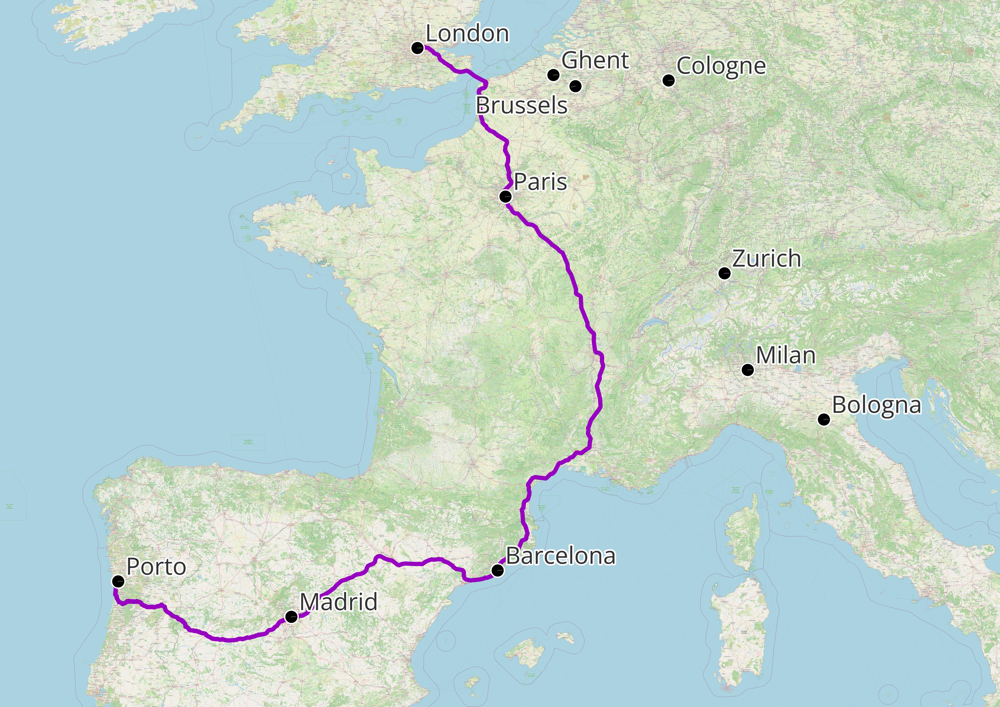
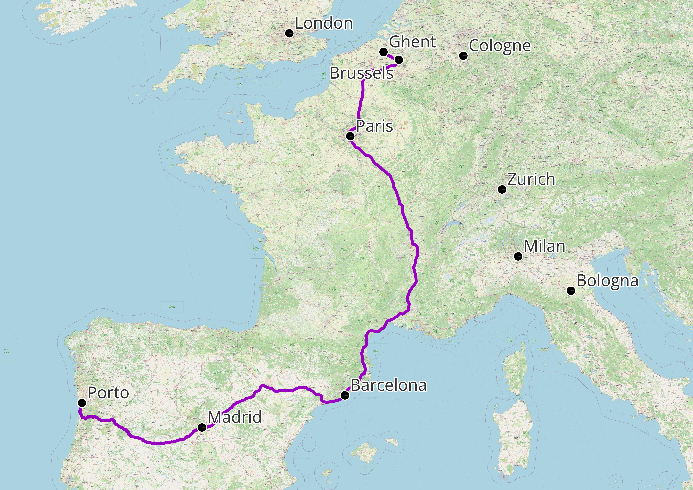
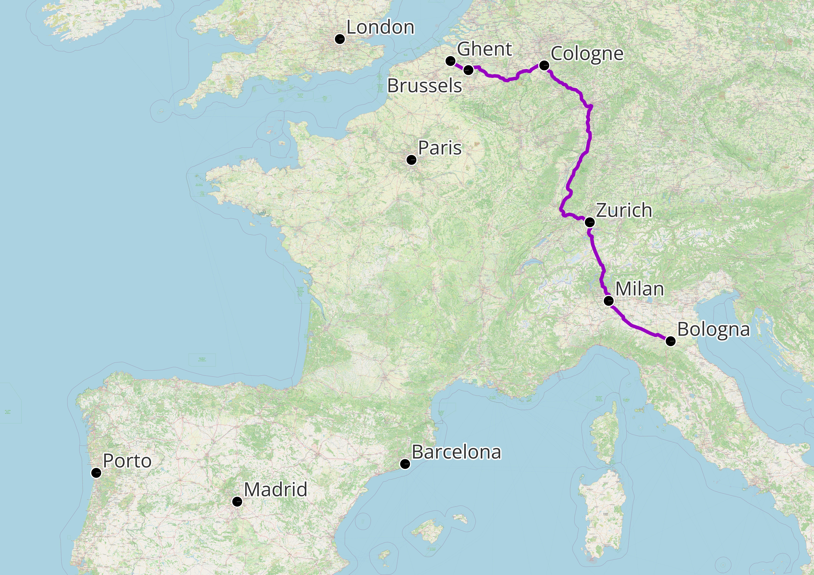
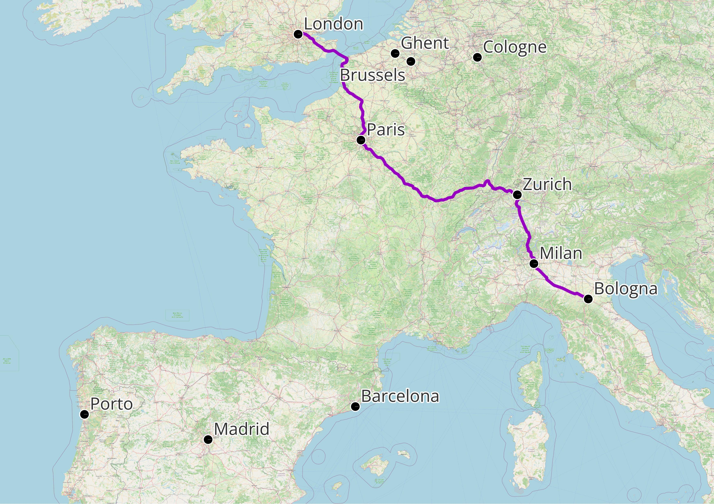

This post was originally meant to come during or immediately after my rail journey, outlining how the trips went, the relative merits of trains and stations, and any adventures I had en route. Now it’s been a month since my return and, honestly, none of that seems particularly interesting or important.

::::::::::::::: {#travel-stages .panel-tabset}
My route across Europe for anyone interested (mainly a georeferenced map making exercise for me)

# Trip 1: London - Porto

::::: {layout-ncol="2"}
::: {.column width="70%"}
{fig-align="left"}
:::

::: {.column width="30%"}
**En route the European Transport Conference!**

-   Day 1: London - Paris

-   Day 2: Paris - Madrid via Barcelona

-   Day 3: Madrid - Porto (by coach)^1^
:::
:::::

# Trip 2: Porto - Ghent

::::: {layout-ncol="2"}
::: {.column width="70%"}

:::

::: {.column width="30%"}
**En route the Climate, Mobility, and Energy Conference!**

-   Day 1: Porto - Madrid (by coach)^1^

-   Day 2: Madrid - Paris via Barcelona

-   Day 3: Paris - Ghent via Brussels
:::
:::::

# Trip 3: Ghent - Bologna

:::::::: {layout-ncol="2"}
::: {.column width="70%"}

:::

::: {.column width="30%"}
**En route visiting my friend!**

-   Day 1: Ghent - Bologna via Brussels, Cologne, Zurich, and Milan^2^
:::

# Trip 4: Bologna - London

::::: {layout-ncol="2"}
::: {.column width="70%"}

:::

::: {.column width="30%"}
**En route home via an academic visit to Zurich!**

-   Day 1: Bologna - Zurich via Milan

-   Day 2: Zurich - London via Paris
:::
:::::

In summary: all went well. I reached all of my destinations (more or less) on time, missed no connections, and somehow managed to have booked tickets for the correct dates and times for every trip. While each train and station were different, they weren’t that different, and I really can’t justify an entire post comparing the details of the wifi speeds or station toilet paper ply. Instead, I want to reflect on my perception of travelling by rail and how it compares to air travel. Since I’ve already covered the details of carbon emissions and cost (briefly) [in a previous article](https://mjmwood.github.io/blog/flight-free-academia.html), forgive my more abstract experience-based discussion here.

I am acutely aware that most of us are usually bound by time constraints and/or financial barriers which mean that flying is the only feasible option for an international trip. But just for a moment I want to suspend disbelief and imagine a world where we are not bound by these artificial restrictions, where we have the time to enjoy life, the freedom to escape our responsibilities, and where sustainable transport is actually affordable.

In this world, we can experience a more human-scale rate of movement. While some high-speed lines travel at a whopping 300km/hr, we are still travelling in a way where we actually engage with the distances travelled. At this pace, on the ground, you can see landscapes and vegetation gradually evolving from the train window, and at each stop or interchange you can feel the temperature differ and hear accents or languages change. In this format, travel facilitates a deeper understanding of how far we’re going and which cultural lines we’re crossing. Compare this with flying, essentially teleporting from one place to another, arriving without seeing, feeling, or even thinking about the places and people between your origin and destination. This ability to be immediately anywhere in the world has the counter-intuitive potential to isolate us from our natural surroundings and societies, eroding our sense of belonging and place.

Separating the destination the journey is example of abstracting results from processes that we see in many aspects of modern life: fast fashion, ultra-processed foods, and especially AI-generated content all present us with what we desire without requiring any acknowledgement of how it was produced. In this way, travel risks becoming simply about the end product rather than a process to engage in. On the other hand, a slower pace of travel encourages a more mindful and curious approach where the journey is truly as important as the destination.

Travelling as fast and directly as possible also removes the potential for unexpected experiences along the way, such as stopovers and interchanges, that add colour and context to the trip. Moreover, it feeds into the toxic capitalist mindset where inefficiency is criminal, and every second must be optimized for maximum productivity. Resisting the temptation to go as fast as we can is therefore, arguably, a step towards ensuring that travel is not transformed into another grey, homogeneous, soulless, and productivity-focused experience.

I realised that I actually think it’s okay if a long distance journey takes a long time. In fact, I think that we can learn to enjoy it as a feature. At a pace that a person can comprehend, slow travel can help us to appreciate how big the world is, how varied it is, and in that way help us to appreciate our roots and our sense of home, place, and belonging.

[Footnotes:]{.underline}

^1^ Trains into Portugal are surprisingly difficult and long-winded, at least in part because of a different rail gauge in parts of Spain and Portugal. From experience, if you can stomach an 8-hour coach journey, it's far less hassle than the multiple trains you need to take via northern Spain to get to Porto

^2^ There's usually an amazing high-speed rail link direct Paris - Milan. Unfortunately it was closed for engineering works in September :(
::::::::
:::::::::::::::
